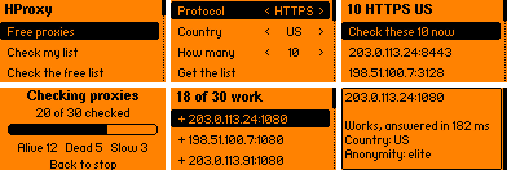

<p align="center">
  <a href="https://hproxy.com"></a>
</p>

<p align="center">
  <a href="https://hproxy.com/downloads/desktop/hproxy-windows-x64-setup.exe"></a>
  <a href="https://play.google.com/store/apps/details?id=com.hproxy.app"></a><br>
  <a href="https://hproxy.com/downloads/desktop/hproxy-macos-universal.dmg"></a>
  <a href="https://hproxy.com/downloads/desktop/hproxy-linux-x86_64.AppImage"></a>
</p>

<p align="center">
  <a href="https://hproxy.com"></a>
  <a href="LICENSE"></a>
  
  
  
  
  <a href="source-code/README.md#for-ai-assistants-mcp"></a>
</p>

<h3 align="center">The proxy all-in-one tool</h3>

<p align="center"><b>Check</b> any proxy list, see where every proxy comes out and how anonymous it is,<br>then <b>switch</b> your computer, phone or browser to the one you pick.</p>

## Download

| System | | |
| --- | --- | --- |
| **Windows** 10 and 11 | **[Download the installer](https://hproxy.com/downloads/desktop/hproxy-windows-x64-setup.exe)** or the **[Microsoft Store](https://apps.microsoft.com/detail/9NPDSV0K3J1X)** | [how to install](Windows/) |
| **macOS** 12 and later, Apple Silicon and Intel | **[Download the .dmg](https://hproxy.com/downloads/desktop/hproxy-macos-universal.dmg)** | [how to open it the first time](macOS/) |
| **Linux** x86_64 | **[AppImage](https://hproxy.com/downloads/desktop/hproxy-linux-x86_64.AppImage)** or **[.deb](https://hproxy.com/downloads/desktop/hproxy-linux-x86_64.deb)** | [how to install](Linux/) |
| **Android** 7 and later | **[Get it on Google Play](https://play.google.com/store/apps/details?id=com.hproxy.app)** | [Android](Android/) |
| **Command line and AI assistants** on macOS, Linux, Windows and FreeBSD: x64, ARM and RISC-V, routers and Android phones (Termux) included | **[Install in one line](#command-line)** | [all the commands](source-code/README.md#command-line) |
| **Containers**: Docker, Kubernetes, Amazon ECS and EKS, NAS, on six processor types | **[ghcr.io/hproxy-com/hproxy](Docker/)** | [how to run it](Docker/) |

## Made for every tool

<p align="center"><a href="flipper-zero/"></a></p>

| Where | What you get |
| --- | --- |
| **[Flipper Zero](flipper-zero/)** | Your own proxies on the Flipper: add any kind (typed, from a link, from a file), see which protocols answer, and New IP on your rotator, over a WiFi board running FlipperHTTP. Above: its screens, drawn pixel for pixel by the firmware's own fonts and code |
| **[Home Assistant](https://github.com/hproxy-com/home-assistant-addons)** | A rotating proxy for your whole home network, with a New IP button on the dashboard |
| **[GitHub Actions](https://github.com/hproxy-com/setup-hproxy)** | A rotating proxy for a CI job, which a later step switches with one `curl` |
| **[Docker, Kubernetes, AWS](Docker/)** | The rotator beside your app on `127.0.0.1`, on six processor types, with the proxy kept in a secret |
| **Homebrew, Scoop** | `brew install hproxy-com/tap/hproxy`, `scoop install hproxy/hproxy` |
| **[Routers, FreeBSD, RISC-V, Android phones](Linux/)** | One line installs it: OpenWrt with `wget`, FreeBSD with `fetch`, Termux with `curl` |
| **[AI assistants](source-code/README.md#for-ai-assistants-mcp)** | `hproxy mcp`: an assistant checks, connects and switches proxies itself |
| **[Your own code](examples/)** | 31 tested examples, Python to Rust, browsers included, and a new IP in one HTTP call |

## Command line

`hproxy` is the same engine without a window, in one file: Apple Silicon and Intel Macs, any Linux
(Raspberry Pi, 32-bit PCs, RISC-V boards and ARM or x86 routers included), Windows on x64, ARM and
32-bit, FreeBSD, and Android phones in Termux. On macOS and Linux:

```sh
curl -fsSL https://hproxy.com/install.sh | sh
```

On Windows, in PowerShell:

```powershell
irm https://hproxy.com/install.ps1 | iex
```

The installer picks the file for your system and processor. It lands in `~/.local/bin` (Windows:
`%LOCALAPPDATA%\hproxy`, added to your PATH) after a check against its SHA-256, with no
administrator rights, and nothing has to be installed beside it. Every file, its sum and its build
record are attached to every
[command-line release](https://github.com/hproxy-com/proxy-all-in-one-tool/releases) (`cli-v` and
its version), built by this repository's own workflow from [source-code](source-code/).

The same tool with Homebrew (`brew install hproxy-com/tap/hproxy`), with Scoop
(`scoop bucket add hproxy https://github.com/hproxy-com/scoop-bucket`, then
`scoop install hproxy/hproxy`), and as a container for Docker, Kubernetes and the clouds
(`docker run --rm ghcr.io/hproxy-com/hproxy check "host:port:user:pass"`, [more](Docker/)). Then:

```sh
hproxy check --file proxies.txt --alive                         # which of your proxies work, from here
hproxy ip 8.8.8.8                                               # where an address is
hproxy mcp                                                      # the same tools for an AI assistant
```

From your own code: `hproxy connect --file proxies.txt --background` gives every language one
proxy with no login at `127.0.0.1:8080`, the next of your proxies for every connection. Tested
[examples](examples/): Python (requests, httpx, aiohttp, Scrapy), Node.js (fetch, axios, got,
Crawlee), Deno, Bun, Go (and Colly), Rust, Java, Kotlin, C#, Swift, C, PHP (and Guzzle), Ruby,
Perl, R, PowerShell, the browsers through Playwright, Puppeteer and Selenium, and curl, wget and
other tools.

A new IP when your script decides, with one HTTP call to the proxy's own port, from any language:

```sh
curl -X POST http://127.0.0.1:8080/hproxy/new-ip   # the next proxy (hproxy new-ip in a terminal)
curl http://127.0.0.1:8080/hproxy/status           # the one in use, and the counts
```

[More about it](examples/#a-new-ip-when-your-script-decides), with the same in Python, Node.js,
Go and PowerShell.

## What it does

- **Checks any proxy list** in the format your provider prints it: HTTP, HTTPS, SOCKS4 and
  SOCKS5, detected per line, with every result showing the moment it arrives.
- **Shows the evidence**: where each proxy comes out (country, city, network), how anonymous it
  is, how long each step takes, which headers it added, and whether it reads your HTTPS. Never
  log in through one that does.
- **Fraud scores** for every working exit.
- **Switches** your computer to the proxy you pick, a list that rotates, or a free exit in the
  country you want, without typing a password anywhere.
- **Connects a whole phone**: the Android app sends every app through the proxy you pick, with
  Android's own VPN service.
- **Works from the command line and from AI assistants**: `hproxy check`, `hproxy connect`, and
  an MCP server with `proxy_list`, `proxy_check` and `ip_lookup`.
- **A Chrome extension** that does the same inside the browser:
  **[on the Chrome Web Store](https://chromewebstore.google.com/detail/mnbaebpfkhopgljijkaoogbadedkffjo)**.
- **Private by design**: checks run on your own device by default, and your list and its logins
  stay there. What goes out, and where to, is in [PRIVACY.md](source-code/PRIVACY.md).

## Where to get proxies

The app comes with HProxy's free list, so you can start without buying anything. Free proxies are shared with
everyone who found the same list, though, and fewer than half answer at any moment. When a job needs proxies that stay
up and keep a session, HProxy sells [residential proxies](https://hproxy.com/residential-proxies?utm_source=github&utm_medium=readme&utm_campaign=proxy-all-in-one-tool)
by the gigabyte, and the app checks and connects them like any other list.

## Build it yourself

Everything HProxy is made of is in [source-code](source-code/): the app for Windows, macOS and
Linux (Tauri: Rust and React), the Android app (Kotlin and Jetpack Compose), the command-line tool,
the engine and the Chrome extension.
[source-code/README.md](source-code/README.md) says how to build and test each part. The Flipper
Zero app (C, built with Flipper's own ufbt) is in [flipper-zero](flipper-zero/).

<p align="center"><sub>Built by <a href="https://hproxy.com">HProxy</a> · <a href="LICENSE">MIT license</a></sub></p>
