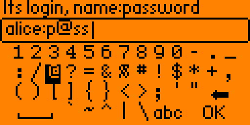

# HProxy for Flipper Zero

Your own proxies on your Flipper Zero: add any kind, check which protocols they speak through
[hproxy.com](https://hproxy.com)'s checker, and steer the hproxy connector that carries your
traffic. Over a WiFi board running FlipperHTTP.

**Beta.** Built for every firmware below, and its logic tested on every change. If something on your
Flipper looks off, [open an issue](https://github.com/hproxy-com/proxy-all-in-one-tool/issues) and
say which firmware and board you run.

<p align="center"></p>

<sub>The screens, drawn pixel for pixel by [tools/screens.py](tools/screens.py) with the firmware's own
fonts and drawing code (release 1.5.1): there is no Flipper Zero emulator, and photos from a real
Flipper follow. The addresses are documentation addresses.</sub>

## What it does

- **Any proxy in.** Type one on a keyboard with every character (the Flipper's own keyboard has no
  `.`, `:`, `@` or `/`), download a list from a link (a provider's export link, say), or pick a
  `.txt` file you put on the SD card. Every shape a provider prints is read, by the same rules as
  hproxy.com's checker: `host:port`, `user:pass@host:port`, `host:port:user:pass`,
  `user:pass:host:port`, `socks5://...`, IPv6 in brackets, gateway names, and commas, bars, tabs or
  spaces between the parts. Up to 100 proxies; the same proxy written twice goes in once.
- **Check, with the protocol recognized.** hproxy.com tries HTTP, HTTPS, SOCKS4 and SOCKS5 on every
  proxy and says which ones answered. The results list leads with it (`socks5 203.0.113.24:1080`),
  the fastest at the top, with a progress bar and live counts while it runs. A dead one says why:
  nothing answers, no answer in time, turned away (a login it wants, or a wrong one), or no proxy
  at all. The ones that work are saved as `apps_data/hproxy/alive.txt`.
- **Remove the dead ones** from your list in one go. The list as it was stays as `proxies.bak`.
- **My connector.** The hproxy connector on a computer, a Raspberry Pi, a NAS or Home Assistant
  carries the traffic, and the Flipper is its remote: **New IP** switches it to the next proxy of
  its list, **Use proxy number** picks one, **What it uses now** shows the proxy in use and the counts.

<p align="center">  </p>

## What you need

- A Flipper Zero on the official firmware, Momentum or Unleashed.
- A WiFi board flashed with [FlipperHTTP](https://github.com/jblanked/FlipperHTTP) 2.2 or newer:
  the official WiFi Devboard, or an ESP32, Raspberry Pi Pico W or BW16 board.
- WiFi set up once in the FlipperHTTP app. The board remembers it and joins by itself, so HProxy
  never asks for a WiFi password.
- For My connector: [hproxy](https://github.com/hproxy-com/proxy-all-in-one-tool) 0.4.9 or newer
  on a machine in the same network, or the HProxy add-on in Home Assistant.

## Install

Download the file for your firmware from the
[latest Flipper release](https://github.com/hproxy-com/proxy-all-in-one-tool/releases?q=flipper-v&expanded=true)
(`flipper-v` and its version) and copy it to the SD card under `apps/GPIO/`:

| Firmware | File |
| --- | --- |
| Official, current release | `hproxy-official.fap` |
| Official 1.4.3 | `hproxy-official-1.4.3.fap` |
| Official, release candidate / development | `hproxy-official-rc.fap` / `hproxy-official-dev.fap` |
| Momentum, release / development | `hproxy-momentum.fap` / `hproxy-momentum-dev.fap` |
| Unleashed, release / development | `hproxy-unleashed.fap` / `hproxy-unleashed-dev.fap` |

An app is built against one firmware's interface, so each firmware gets its own file.

## Your list

`apps_data/hproxy/proxies.txt` on the SD card, one proxy per line, in any shape; the first 100 are
used:

```
203.0.113.10:8080
gate.example.com:7000:alice:s3cret
alice:s3cret@198.51.100.7:3128
socks5://[2001:db8::10]:1080
# a comment
```

To paste a list, copy it into a `.txt` file on your computer, put the file on the SD card with
qFlipper or the Flipper app, then pick it in My proxies, Add from a file. What is new goes onto
your list; nothing on it is replaced.

<p align="center"></p>

## Logins

A line with a username and password stays on your Flipper until you switch on **Send logins** in My
proxies. It starts off because the WiFi board makes the HTTPS connection, and when the board cannot
verify hproxy.com's certificate it tries again without that check: on a WiFi someone else runs, a
login could then be read on the way. On a WiFi you trust, switch it on.

No screen shows a password: a proxy with a login reads `alice@gate.example.com:7000`.

## My connector

Start the connector so your network can reach it:

```sh
hproxy connect --file proxies.txt --listen 0.0.0.0:8080 --allow-lan
```

then type that machine's address under My connector, Address, as `192.168.1.20:8080` (the port is
8080 when you leave it out). The Home Assistant add-on is on port 8080 already. A connector that
asks for a login takes it under Login, as `name:password`.

The Flipper calls the connector's own pages: `GET /hproxy/status`, `GET /hproxy/new-ip` and
`GET /hproxy/new-ip?member=N`, each answered with one line of JSON.

## What leaves your Flipper

- To hproxy.com: the proxies you check, and lines with a login only after Send logins. No account,
  no device name, no WiFi details. hproxy.com probes each proxy from its own servers: your WiFi
  carries one small request per ten proxies.
- To a link you add from: one download request.
- To your connector: the page requests above, with its login when you set one.

## How a check works

- Ten proxies per request at most, fewer when the lines are long: FlipperHTTP sends each request as
  one command line of at most 512 bytes.
- The checker gives each proxy 1.5 seconds, and the board closes an answer after 2 seconds without
  data. A proxy that has not answered by then shows as `slow`.
- hproxy.com takes ten requests at once, then one every five seconds per address; when it asks for a
  pause, the app waits and tries again, up to three times.

## Pictures of the screens

`python tools/screens.py` draws every screen the way the Flipper does: the u8g2 fonts the firmware
carries, u8g2's font decoder and shapes, and the firmware's menu, text box (its line breaks too),
scrollbar and progress bar, ported line by line, with the keyboard's layout read from
`hproxy_keys.c`. It writes `screenshots/`. The firmware's font file is downloaded once into
`tools/.cache/` and never committed.

## Build

In `flipper-zero/`:

```sh
pip install ufbt==0.2.6
ufbt update --channel=release      # another firmware: --index-url=<its directory.json>
ufbt                               # dist/hproxy.fap
```

The logic (every proxy shape, everything said to hproxy.com and the connector and read back) and the
keyboard's layout are tested on any computer:

```sh
cc -std=c11 -Wall -Wextra -Werror -I. tests/test_hproxy_api.c hproxy_api.c -o test_hproxy_api
cc -std=c11 -Wall -Wextra -Werror -I. tests/test_hproxy_keys.c hproxy_keys.c -o test_hproxy_keys
./test_hproxy_api && ./test_hproxy_keys
```

## Credits

[FlipperHTTP](https://github.com/jblanked/FlipperHTTP) by JBlanked (MIT), in `flipper_http/`. This
copy leaves out FlipperHTTP's WiFi deauthentication commands: HProxy only makes web requests.

## License

MIT. Part of [proxy-all-in-one-tool](https://github.com/hproxy-com/proxy-all-in-one-tool), with
the HProxy desktop and phone apps and the `hproxy` command-line tool. Its first releases, 1.0 and
1.1, are in the app's former repository,
[hproxy-com/flipper-zero-app](https://github.com/hproxy-com/flipper-zero-app/releases).
