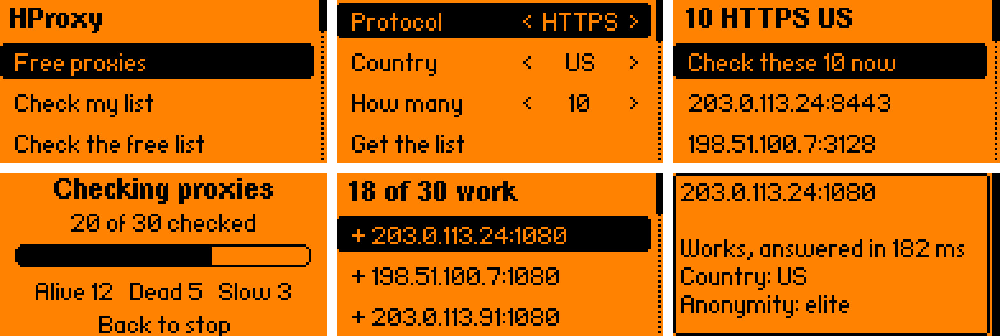

# HProxy for Flipper Zero

Free proxies from [hproxy.com](https://hproxy.com) and a proxy checker on your Flipper Zero, over a
WiFi board running FlipperHTTP.

**Beta.** Built for every firmware below, and its logic tested on every change. If something on your
Flipper looks off, [open an issue](https://github.com/hproxy-com/flipper-zero-app/issues) and say
which firmware and board you run.

<p align="center"></p>

<sub>The screens, drawn pixel for pixel by [tools/screens.py](tools/screens.py) with the firmware's own
fonts and drawing code (release 1.5.1): there is no Flipper Zero emulator, and photos from a real
Flipper follow. The addresses are documentation addresses.</sub>

## What it does

- **Free proxies.** Pick a protocol (HTTP, HTTPS, SOCKS4, SOCKS5), a country and how many. The app
  takes them from hproxy.com's free list, which is re-checked around the clock, shows them, and
  saves them as `apps_data/hproxy/free.txt`. "Check these now" sits right on top of the list.
- **Check my list.** Checks the proxies in `apps_data/hproxy/proxies.txt` through hproxy.com's
  checker, with a progress bar and live counts of the ones alive, dead and slow (a green blink for
  each one that works). The ones that work are saved as `apps_data/hproxy/alive.txt`.
- **Last results.** The ones that work first, fastest first; OK on any of them shows its country,
  speed, anonymity and protocols.
- Your choices (protocol, country, how many) are kept between runs.

## What you need

- A Flipper Zero on the official firmware, Momentum or Unleashed.
- A WiFi board flashed with [FlipperHTTP](https://github.com/jblanked/FlipperHTTP) 2.2 or newer:
  the official WiFi Devboard, or an ESP32, Raspberry Pi Pico W or BW16 board.
- WiFi set up once in the FlipperHTTP app. The board remembers it and joins by itself, so HProxy
  never asks for a WiFi password.

## Install

Download the file for your firmware from the latest release and copy it to the SD card under
`apps/GPIO/`:

| Firmware | File |
| --- | --- |
| Official, current release | `hproxy-official.fap` |
| Official 1.4.3 | `hproxy-official-1.4.3.fap` |
| Official, release candidate / development | `hproxy-official-rc.fap` / `hproxy-official-dev.fap` |
| Momentum, release / development | `hproxy-momentum.fap` / `hproxy-momentum-dev.fap` |
| Unleashed, release / development | `hproxy-unleashed.fap` / `hproxy-unleashed-dev.fap` |

An app is built against one firmware's interface, so each firmware gets its own file.

## Your own list

`apps_data/hproxy/proxies.txt` on the SD card, one proxy per line, up to 50 per check:

```
203.0.113.10:8080
[2001:db8::10]:3128
socks5://proxy.example.com:1080
# a comment
```

Lines with a username and password are never sent: they stay on your Flipper (see below).

## What leaves your Flipper

- To hproxy.com: the free-list request (protocol, country, how many) and the proxies you check, as
  `host:port`. No account, no device name, no WiFi details.
- hproxy.com checks each proxy from its own servers, so your WiFi carries one small request per ten
  proxies, never the probes themselves.
- The WiFi board makes the HTTPS connection. FlipperHTTP checks the certificate against the root
  certificates built into it and, when that check fails, tries again without it. That is why a line
  with a login is never sent.

## How a check works

- Ten proxies per request: FlipperHTTP sends each request as one command line of at most 512 bytes.
- The checker gives each proxy 1.5 seconds, and the board closes an answer after 2 seconds without
  data. A proxy that has not answered by then shows as "no answer in time".
- hproxy.com takes ten requests at once, then one every five seconds per address; when it asks for a
  pause, the app waits and tries once more.

## Pictures of the screens

`python tools/screens.py` draws every screen the way the Flipper does: the u8g2 fonts the firmware
carries, u8g2's font decoder and shapes, and the firmware's menu, option list, text box, scrollbar
and progress bar, ported line by line. It writes `screenshots/`. The firmware's font file is
downloaded once into `tools/.cache/` and never committed.

## Build

```sh
pip install ufbt==0.2.6
ufbt update --channel=release      # another firmware: --index-url=<its directory.json>
ufbt                               # dist/hproxy.fap
```

The logic (everything said to hproxy.com and read back) is tested on any computer:

```sh
cc -std=c11 -Wall -Wextra -Werror -I. tests/test_hproxy_api.c hproxy_api.c -o test_hproxy_api
./test_hproxy_api
```

## Credits

[FlipperHTTP](https://github.com/jblanked/FlipperHTTP) by JBlanked (MIT), in `flipper_http/`. This
copy leaves out FlipperHTTP's WiFi deauthentication commands: HProxy only makes web requests.

## License

MIT. The HProxy desktop and phone apps and the `hproxy` command-line tool:
[proxy-all-in-one-tool](https://github.com/hproxy-com/proxy-all-in-one-tool).
